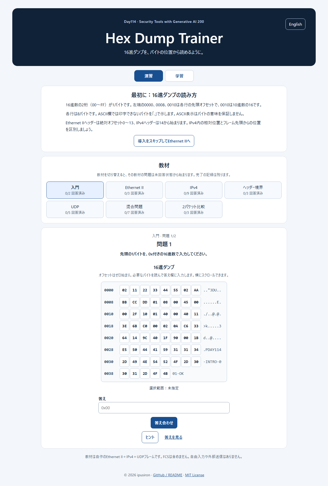
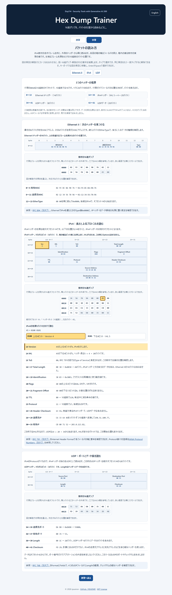
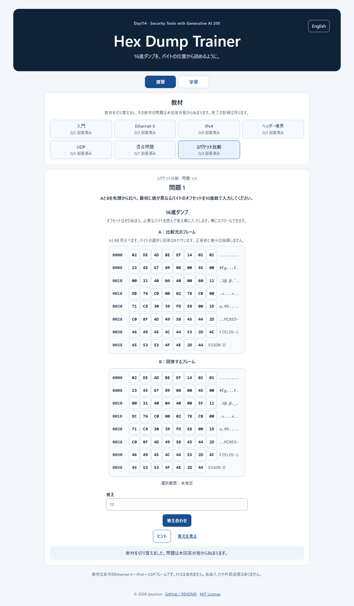
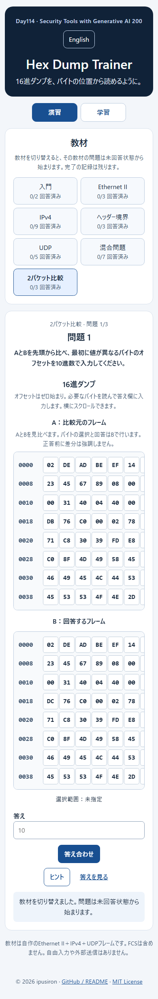
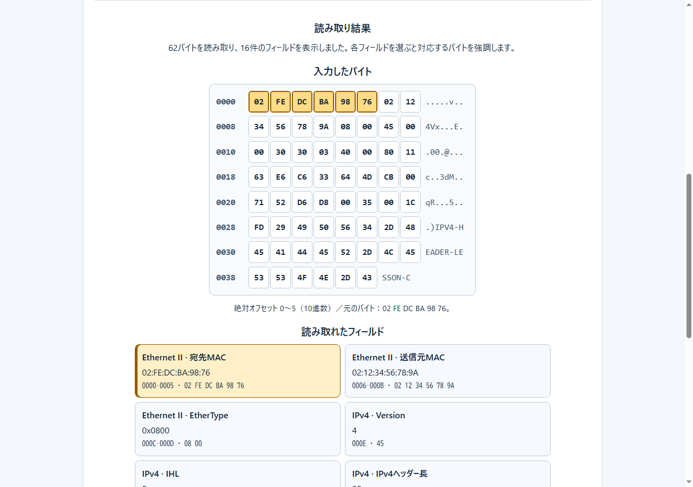
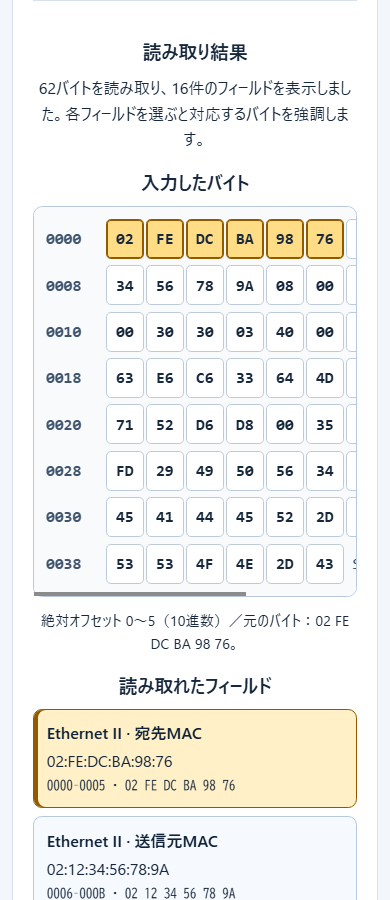
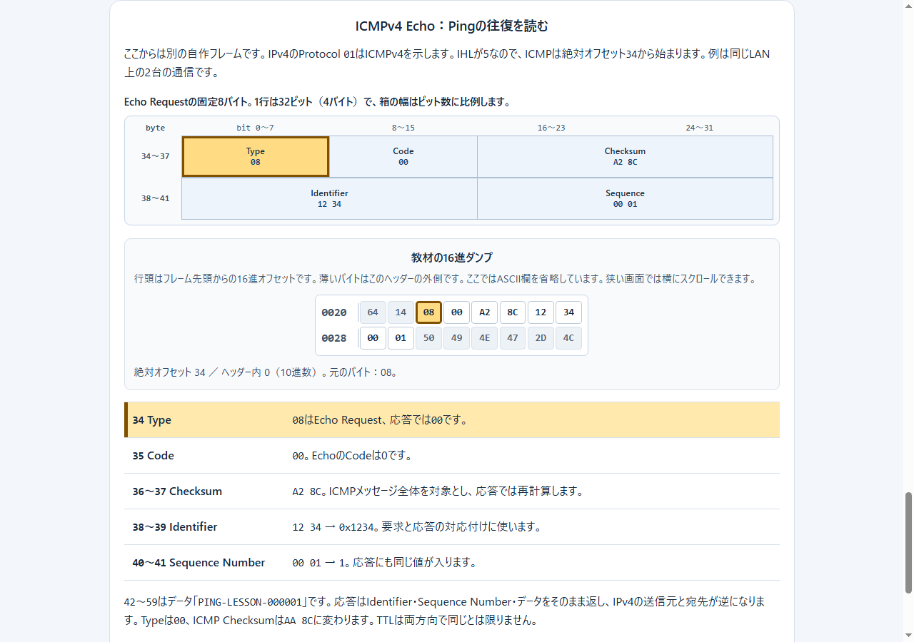
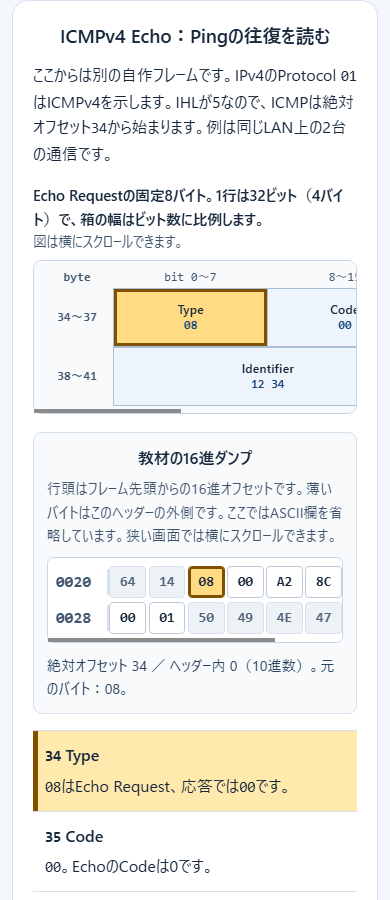

# Hex Dump Trainer - Learn to Read Hex Dumps


[](https://ipusiron.github.io/hex-dump-trainer/)

[日本語](README.md)

**Day114 - Security Tools with Generative AI 200**

Hex Dump Trainer is an interactive learning tool for finding byte positions in a hex dump and reading Ethernet II, IPv4, UDP, and ICMPv4 Echo headers.
If you are new to hex dumps, you can start with a short introduction.
No book is required.
The Learn tab uses packet diagrams, hex bytes from built-in frames, offset explanations, and links to the relevant RFCs to explain Ethernet II, IPv4, UDP, and ICMPv4 Echo. Matching diagram fields, explanation rows, and original bytes highlight together.

## 🌐 Live app

👉 **[Open Hex Dump Trainer](https://ipusiron.github.io/hex-dump-trainer/)**

The exercises run in a browser and use original frames; no book is required.
The Your dump tab also lets you paste your own hex text and match readable fields to their original bytes locally.

## 📸 Screenshot

















## ✨ What you will learn

- How zero-based offsets correspond to byte positions
- How field order and widths appear in packet diagrams (32-bit rows for IPv4, UDP, and ICMPv4 Echo)
- How to match diagram fields, explanation rows, and original hex bytes by hover, tap, or keyboard
- How frame-absolute and header-relative offsets differ, and how Version and IHL split one byte into two four-bit values
- How to locate Ethernet II destination and source MAC addresses and EtherType
- How to read IPv4 Version, IHL, Total Length, TTL, Protocol, and source and destination addresses
- How to calculate the IPv4 header length from IHL
- How to locate header boundaries from EtherType, IHL, and Protocol
- How to locate and read UDP ports, Length, and the Checksum field in graded exercises
- How to read Echo Request and Reply Type, Code, Checksum, Identifier, Sequence Number, and data
- How IPv4 addresses reverse across a Ping exchange, and why the sender measures RTT rather than reading it from an Echo header field
- How to compare two frames to find the first changed byte, TTL, and IPv4 header checksum
- How to match fields in your own hex dump to their original bytes

## 📖 How to use

1. Use the Learn tab to compare each header diagram with the lesson dump directly below it. Hover over a diagram field or explanation row to highlight its original bytes; tap or press Enter/Space on a diagram field to select it. The selected field shows its absolute and header-relative offsets and hex bytes. On narrow screens, scroll the diagram and dump separately. Switching back to Exercises keeps the answer you were entering.
2. Complete the two introductory questions or skip to Ethernet II. You can switch lessons at any time.
3. For range questions, select the start and end bytes. Decimal offset inputs provide an alternative for small screens and keyboards.
4. For value and calculation questions, enter the notation requested in the question.
5. Check your answer. You can retry after a wrong answer. Hints progress through header, relative offset, and answer reveal; Show answer reveals it directly.
6. In Your dump, choose an input format, paste one frame of hex text, and press Inspect. Select a field to highlight its bytes. This tab does not grade input.

Header boundaries asks you to identify the IPv4 range and UDP start. UDP asks for ports, Length, and the Checksum field. Compare two packets shows frames A and B; compare them from the start to find the first difference and read values from B. Differences are not highlighted before grading.
ICMPv4 Echo covers the fixed eight bytes of a request. Ping request and reply presents request A and reply B side by side to compare Type, Checksum, Identifier, Sequence Number, and IPv4 addresses. It sends no network traffic.

Changing languages preserves the active tab, current question, selection, input, and result. Switching lessons starts the selected lesson unanswered while keeping its completion record.

Your dump accepts raw hexadecimal with optional whitespace (for example, `02 FE DC BA 98 76`) or contiguous offset-labelled rows (for example, `0000: 02 FE DC BA 98 76`). Offset rows begin at `0000` and contain 1–16 bytes each. Input is limited to 16,384 text characters and 4,096 decoded bytes per frame. `0x` notation, ASCII columns, and pcap/pcapng files are not accepted.

## 🔧 Getting started

Open the [published page](https://ipusiron.github.io/hex-dump-trainer/) or open the local `index.html` directly. It also works through `file://`; no installation or server is required.

## 🔬 Worked example

The Total Length in the IPv4 lesson occupies absolute frame offsets `16–17`, or offsets `2–3` relative to the IPv4 header beginning at `14`.
The bytes are `00 30`. Read in network byte order, they form `0x0030`, or `48` bytes in decimal. The 14-byte Ethernet II header is not part of this Total Length.

## 🎯 Use cases

Ways of using this tool in particular

- Correcting a check value by the difference alone (checking sums in mathematics and bookkeeping): the IPv4 header checksum adds the header in 16-bit words (a carry out of the top is added back at the bottom) and inverts the bits of the sum. In Compare two packets, the first byte that differs is the TTL at offset `22`; the TTL drops by 1 from `96` to `95`, and the checksum rises by `0x0100` (256) from `0xDB76` to `0xDC76`. The TTL is the upper byte of its 16-bit word, so a drop of 1 lowers the word by 256, and the inverted sum rises by the same amount. In Ping request and reply, Type changes from `8` to `0`, and the ICMP Checksum rises by `0x0800` (2,048) from `0xA28C` to `0xAA8C`. It is the same idea as correcting a ledger total by the difference after fixing one line, instead of adding everything again. [RFC 1624](https://www.rfc-editor.org/rfc/rfc1624.html) describes this method, which spares a router from adding up the whole header each time it decrements the TTL. The tool does not recalculate checksums, so work out the difference from the displayed values yourself.
- Estimating the share of headers when sending small data (IoT and embedded device design): in the UDP lesson, the UDP Length is `29`; subtracting the 8-byte UDP header leaves 21 bytes of data. Adding the 14-byte Ethernet II header to the IPv4 Total Length of `49` gives a 63-byte frame, of which 42 bytes, exactly two thirds, are Ethernet II, IPv4, and UDP headers. By counting bytes, you can show that when small data such as sensor readings is sent one item at a time, most of what is sent is header. Packing several items into one frame lowers the header share. The lesson bytes omit the FCS (4 bytes), so on a real link the part other than data grows further.
- Showing that the reading order changes a value, side by side with date formats (information classes): just as "03/04" means March 4 in some countries and 3 April in others, a value of two or more bytes changes with the reading order. The Identifier `12 34` in Ping request and reply is `0x1234` (4,660) in network byte order, read from the upper byte, and `0x3412` (13,330) when read the other way. The Sequence Number `00 01` likewise splits into 1 and 256. The sender uses these two fields to pair requests with replies, and the replier returns the received values unchanged, so the byte order the sender writes can differ between implementations. That is why Wireshark shows two values side by side, such as `Identifier (BE)` and `Identifier (LE)`. This tool shows only the value read from the upper byte.

General uses

- Read `08 00` at offsets `12–13` as `0x0800` to recognize the following IPv4 header.
- Split `45` into Version `4` and IHL `5`, then calculate an IPv4 header length of `20` bytes.
- Convert `C6 33 64 4D` byte by byte into `198.51.100.77`.
- Select a byte range before revealing the evidence, rather than reading a completed decode table.

## ⚠️ Scope and limitations

The lessons use Ethernet II frames containing IPv4 headers without options. The sample byte arrays omit the frame check sequence (FCS).
The original UDP and ICMPv4 Echo frames have consistent lengths and checksums. Field values are graded, but checksum recalculation is not required.
Your dump displays complete, readable Ethernet II, IPv4, UDP, and ICMPv4 Echo fields. IPv4 options are shown as a byte range, and IHL moves the upper-header start. Truncated input, inconsistent lengths, and unsupported EtherTypes or Protocol values produce warnings. Fragments are not reassembled, and checksum validity is not checked.
Only Echo-specific fields (Type 0 or 8, Code 0) are inspected. Other ICMPv4 types show only Type, Code, and Checksum. VLAN, IPv6, ARP, TCP, ICMPv6, and pcap/pcapng import are not supported.

## 🔒 Data and privacy

Answers, progress, and your pasted text and result stay in page memory and disappear on reload. The app does not put your input in the URL or send input or answers elsewhere. Take care with dumps containing confidential data. Following a GitHub link navigates to GitHub.

## 🧪 Development and tests

The app uses only HTML, CSS, and JavaScript, with no package dependencies. With Node.js 22, run the byte-reading, grading, all-question, seven-frame IPv4/UDP/ICMPv4 length and checksum, and free-input parsing tests (45 questions):

```sh
node --test test/*.test.js
```

CI runs the same tests and JavaScript syntax checks. The interface has been checked locally with `file://` and HTTP at widths from 320 to 1280 pixels.
If Chrome is installed locally, run `node test/browser_qa.mjs "<Chrome executable>"` to test `file://` input interactions and 320, 390, 768, and 1280px layouts. An HTTP(S) URL may be passed as the second argument. This optional test saves Your dump screenshots under `assets/`.

## 📁 Directory structure

```text
hex-dump-trainer/
├── .github/workflows/test.yml # Test CI
├── .gitignore               # Exclude local secrets and generated files
├── assets/screenshot-desktop-20261015.png # Interface screenshot
├── assets/screenshot-learning-20261015.png # Learn tab screenshot
├── assets/screenshot-comparison-20261015.png # Two-packet comparison screenshot
├── assets/screenshot-comparison-mobile-20261015.png # Mobile comparison screenshot
├── assets/screenshot-free-input-{390,1280}.png # Your dump screenshots
├── assets/screenshot-icmp-learning-{390,1280}.png # ICMPv4 learning screenshots
├── index.html               # Exercise, learning, and input interface
├── style.css                # Mobile-first styles
├── app.js                   # Interface, tabs, and progress
├── core.js                  # Byte reading, grading, and input inspection
├── data.js                  # Versioned original lessons
├── test/                    # Dependency-free tests
├── README.md                # Japanese
├── README.en.md             # English
└── LICENSE                  # MIT License
```

## 📄 License

This project uses the MIT License. See [LICENSE](LICENSE) for the full text.

## 🔗 References

- [RFC 894: A Standard for the Transmission of IP Datagrams over Ethernet Networks](https://www.rfc-editor.org/rfc/rfc894.html)
- [RFC 791: Internet Protocol](https://www.rfc-editor.org/rfc/rfc791.html)
- [RFC 768: User Datagram Protocol](https://www.rfc-editor.org/rfc/rfc768.html)
- [RFC 792: Internet Control Message Protocol](https://www.rfc-editor.org/rfc/rfc792.html)
- [IANA: Protocol Numbers](https://www.iana.org/assignments/protocol-numbers/)
- [RFC 5737: IPv4 Address Blocks Reserved for Documentation](https://www.rfc-editor.org/rfc/rfc5737.html)

## 🛠️ About this tool

This project is part of [Security Tools with Generative AI 200](https://akademeia.info/?page_id=44607).
