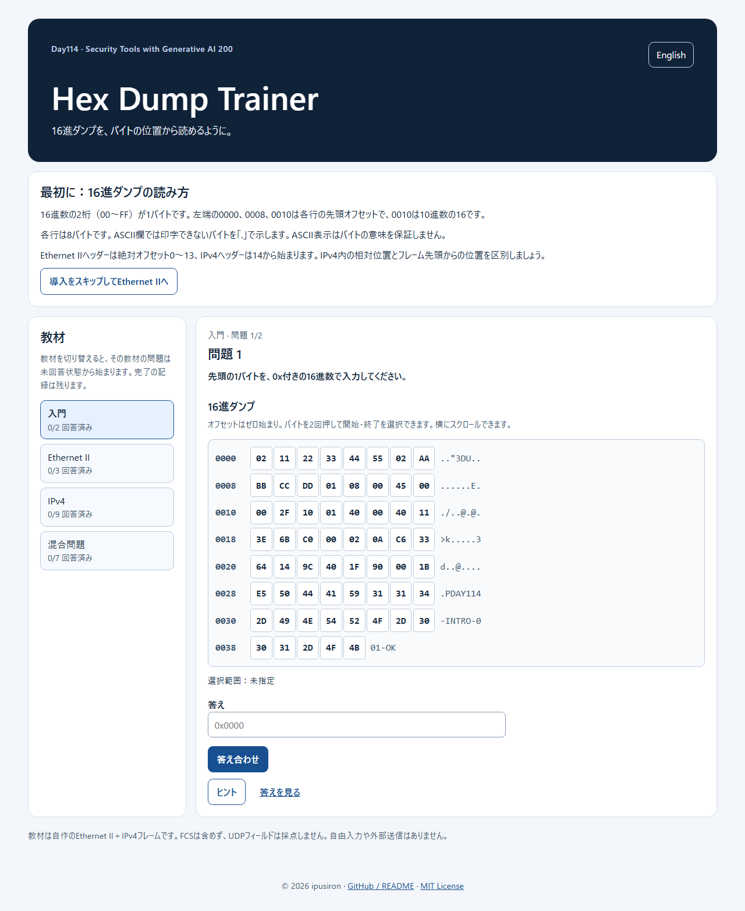

<!--
---
id: day114
slug: hex-dump-trainer

title: "Hex Dump Trainer"

subtitle_ja: "16進ダンプを自分で読む演習"
subtitle_en: "Learn to Read Hex Dumps"

description_ja: "16進ダンプのバイト位置を探し、Ethernet IIとIPv4のヘッダーを読み解く初学者向け演習ツール"
description_en: "Beginner-friendly exercises for locating bytes in hex dumps and reading Ethernet II and IPv4 headers"

category_ja:
  - ネットワーク
category_en:
  - Networking

difficulty: 1

tags:
  - hex-dump
  - ethernet
  - ipv4
  - networking
  - education

repo_url: "https://github.com/ipusiron/hex-dump-trainer"
demo_url: "https://ipusiron.github.io/hex-dump-trainer/"

hub: false
---
-->

# Hex Dump Trainer - 16進ダンプを自分で読む演習


[](https://ipusiron.github.io/hex-dump-trainer/)

[English](README.en.md)

**Day114 - 生成AIで作るセキュリティツール200**

Hex Dump Trainerは、16進ダンプの中からバイトの位置を探し、Ethernet IIとIPv4のヘッダーを自分で読み解く演習ツールです。
16進ダンプを初めて見る人は、短い導入練習から始められます。
書籍がなくても使えます。

## 🌐 デモページ

👉 **[Hex Dump Trainerを開く](https://ipusiron.github.io/hex-dump-trainer/)**

ブラウザーだけで演習できます。教材は書籍を必要としない自作フレームです。

## 📸 スクリーンショット



## ✨ 学べること

- ゼロ始まりのオフセットとバイトの位置の対応
- Ethernet IIの宛先MACアドレス、送信元MACアドレス、EtherType
- IPv4のVersion、IHL、Total Length、TTL、Protocol、送信元アドレス、宛先アドレス
- IHLからのIPv4ヘッダー長の計算

## 📖 使い方

1. 入門の2問から始めるか、導入をスキップしてEthernet IIへ進みます。教材一覧からいつでも切り替えられます。
2. 位置問題では開始・終了のバイトを順に選びます。小さい画面やキーボード操作では、10進数のオフセット入力も使えます。
3. 値問題・計算問題では、問題文で指定された表記の答えを入力します。
4. 「答え合わせ」で確認します。誤答なら再挑戦でき、ヒントは対象ヘッダー→相対位置→解答表示の3段階です。「答えを見る」でも解答を表示できます。

日英を切り替えても、表示中の問題、選択範囲、入力値、結果は保持されます。教材の切り替え時は、その教材の問題が未回答状態から始まり、完了記録は残ります。

## 🔧 起動方法

[公開ページ](https://ipusiron.github.io/hex-dump-trainer/)へアクセスするか、ローカルの`index.html`を直接開いてください。`file://`でも動作します。インストールやサーバーは不要です。

## 🔬 解答例

IPv4教材のTotal Lengthは、フレーム先頭からの絶対オフセット`16〜17`、IPv4ヘッダー先頭（`14`）からの相対オフセット`2〜3`にあります。
該当バイトは`00 30`です。ネットワークバイト順に`0x0030`と読み、10進数へ変換すると`48`バイトです。Ethernet IIヘッダーの14バイトは、このTotal Lengthに含みません。

## 🎯 ユースケース

- オフセット`12〜13`の`08 00`を`0x0800`と読み、後続がIPv4であると確かめる。
- `45`の上位4ビットからVersion `4`、下位4ビットからIHL `5`を取り、IPv4ヘッダー長`20`バイトを求める。
- `C6 33 64 4D`を1バイトずつ10進数に変換し、`198.51.100.77`と読む。
- 答えを先に表示せず、バイト範囲を選んでから根拠を確認する。

## ⚠️ 教材の範囲と制限

教材はオプションなしのIPv4を含むEthernet IIフレームに限定します。
教材のバイト列にフレームチェックシーケンス（FCS）は含めません。
後続データは長さ・チェックサムが整合したUDPデータグラムですが、UDPのフィールドは採点しません。
VLAN、IPv6、ARP、IPフラグメント、IPv4オプション、自分の16進ダンプの貼り付け、ICMPv4、pcap/pcapngの読込には対応しません。

## 🔒 データとプライバシー

自作の内蔵教材のみを扱い、自由入力はありません。回答と進捗はページ内のメモリーだけに保持し、再読み込みで消えます。アプリ自身は回答を外部へ送信しません。GitHubのリンクを押した場合は、GitHubのサイトへ移動します。

## 🧪 開発と検証

HTML/CSS/JavaScriptのみで動作し、依存パッケージはありません。Node.js 22で次を実行すると、採点、全21問、4つの教材フレームのIPv4/UDP長・チェックサムを検証できます。

```sh
node --test test/*.test.js
```

CIでも同じテストとJavaScript構文検査を実行します。画面はローカルの`file://`とHTTP、320〜1280pxで確認しています。

## 📁 ディレクトリー構造

```text
hex-dump-trainer/
├── .github/workflows/test.yml # テストCI
├── .gitignore               # ローカルの機密ファイルなどを除外
├── assets/screenshot-desktop.png # 画面例
├── index.html               # 演習画面
├── style.css                # モバイル優先のスタイル
├── app.js                   # 画面と進捗
├── core.js                  # バイト読取・採点
├── data.js                  # バージョン付き自作教材
├── test/                    # 依存なしの自動テスト
├── README.md                # 日本語版
├── README.en.md             # 英語版
└── LICENSE                  # MIT License
```

## 📄 ライセンス

MIT Licenseです。全文は[LICENSE](LICENSE)を参照してください。

## 🔗 参照資料

- [RFC 894: A Standard for the Transmission of IP Datagrams over Ethernet Networks](https://www.rfc-editor.org/rfc/rfc894.html)
- [RFC 791: Internet Protocol](https://www.rfc-editor.org/rfc/rfc791.html)
- [RFC 768: User Datagram Protocol](https://www.rfc-editor.org/rfc/rfc768.html)
- [RFC 5737: IPv4 Address Blocks Reserved for Documentation](https://www.rfc-editor.org/rfc/rfc5737.html)

## 🛠️ このツールについて

本ツールは、「生成AIで作るセキュリティツール200」プロジェクトの一環として開発しました。
プロジェクトの詳細は[生成AIで作るセキュリティツール200](https://akademeia.info/?page_id=44607)をご覧ください。
